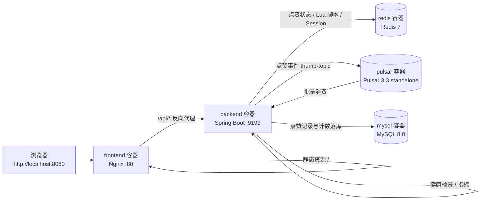

# 点赞系统 Docker 本地部署指南

> 适用项目：`yu-like`（Spring Boot 3.4.3 后端 + Vue 3 前端）
> 实测环境：Windows 11、Docker Desktop 29.8.2、Docker Compose v5.6.0、16 核 / 16 GB
> 说明：课程文档《后端本地部署运行（鱼皮代码版）》需要登录才能查看正文，本指南以仓库实际代码为准，文末列出与教程架构的差异。

---

## 1. 方案概览

### 1.1 架构与请求链路



关键点：本项目实际生效的 `ThumbService` 是 `thumbService`（`ThumbServiceMQImpl`），点赞写 Redis 后发 Pulsar 事件，再由消费者批量落 MySQL。**Redis 与 Pulsar 缺一不可**，只起 MySQL 无法完成点赞。

### 1.2 组件与端口

| 服务 | 镜像 | 容器名 | 宿主机端口 | 说明 |
|---|---|---|---|---|
| MySQL | `mysql:8.0` | `thumb-mysql` | `13306` | 数据库 `thumb_db` |
| Redis | `redis:7.2-alpine` | `thumb-redis` | `16379` | 点赞状态、Spring Session |
| Pulsar | `apachepulsar/pulsar:3.3.4` | `thumb-pulsar` | `16650` / `18080` | 消息队列 / Admin API |
| 后端 | 本地构建 `thumb-backend:local` | `thumb-backend` | `9199` | Spring Boot |
| 前端 | 本地构建 `thumb-front:local` | `thumb-front` | `8080` | Nginx + 静态资源 |

内部访问一律走 compose 网络中的服务名：`mysql`、`redis`、`pulsar`、`backend`。

### 1.3 启动顺序

```text
mysql / redis / pulsar 并行启动
        ↓ healthcheck 通过
backend 启动（连接三个中间件）
        ↓ healthcheck 通过
frontend 启动
```

`depends_on: condition: service_healthy` 保证后端不会在中间件未就绪时启动，避免 `Communications link failure` 与 Pulsar 连接超时。

---

## 2. 前置条件

### 2.1 必需

- Docker Desktop（Windows）已安装并启动，建议内存分配 ≥ 8 GB（本项目 Pulsar 约 1.5 GB、MySQL 约 0.5 GB）。
- 磁盘可用空间 ≥ 8 GB（镜像约 4 GB + 数据卷）。
- 端口 `8080`、`9199`、`13306`、`16379`、`16650`、`18080` 未被占用。

**不需要**在本机安装 Java、Maven、Node：后端与前端都在镜像内完成构建。

### 2.2 环境自检

```powershell
docker --version
docker compose version
docker info --format "{{.NCPU}} CPU / {{.MemTotal}} bytes"
```

端口占用检查（任一路由被占用时修改 `docker-compose.yml` 中冒号左侧端口）：

```powershell
8080,9199,13306,16379,16650,18080 | ForEach-Object {
    $p = $_
    if (Get-NetTCPConnection -LocalPort $p -State Listen -ErrorAction SilentlyContinue) {
        "端口 $p 已被占用"
    } else {
        "端口 $p 空闲"
    }
}
```

---

## 3. 部署文件清单

| 文件 | 状态 | 作用 |
|---|---|---|
| `Dockerfile` | 新增 | 后端多阶段构建：Maven 打包 → JRE 运行 |
| `.dockerignore` | 新增 | 排除 `target`、`thumb-front`、`public` 等，加速构建 |
| `src/main/resources/application-docker.yml` | 新增 | 容器内数据源、Redis、Pulsar、Session 配置 |
| `docker-compose.yml` | 新增 | 五个服务、健康检查、数据卷、网络 |
| `thumb-front/Dockerfile` | 新增 | Node 构建静态资源 → Nginx 托管 |
| `thumb-front/nginx.conf` | 新增 | SPA 路由回退 + `/api` 同源反代 + Cookie 透传 |
| `thumb-front/.dockerignore` | 新增 | 排除 `node_modules`、`dist` |
| `deploy/mysql/02-seed.sql` | 新增 | 演示用户与博客数据 |
| `sql/create_table.sql` | 原有 | 首次启动自动建表 |
| `public/images` | 原有 | 只读挂载给前端，作为演示博客封面 |

> 原有 `application.yml` **未修改**，IDE 本地开发方式不受影响。

---

## 4. 首次部署（详细步骤）

### 步骤 1：进入项目根目录

```powershell
cd c:\Users\15X\Desktop\yu-like
```

### 步骤 2：确认 Docker 引擎已就绪

```powershell
docker info
```

若报 `Cannot connect to the Docker daemon`，先启动 Docker Desktop，等待鲸鱼图标变绿。

### 步骤 3：构建镜像（首次较慢）

```powershell
docker compose build
```

首次会拉取 `maven:3.9-eclipse-temurin-21`、`eclipse-temurin:21-jre-alpine`、`node:22-alpine`、`nginx:1.27-alpine`，并在容器内下载 Maven 依赖与 npm 依赖，整体约 3–6 GB。后续构建会复用 BuildKit 的 Maven 缓存与 Docker 层缓存。

只重建后端：

```powershell
docker compose build backend
```

只重建前端：

```powershell
docker compose build frontend
```

### 步骤 4：启动全部服务

```powershell
docker compose up -d
```

首次启动时 MySQL 会自动执行：

1. `sql/create_table.sql`：创建 `thumb_db` 与 `user`、`blog`、`thumb` 三张表；
2. `deploy/mysql/02-seed.sql`：插入 6 个演示用户、8 篇演示博客。

> 初始化脚本**只在 `mysql-data` 卷为空时执行**。若之前启动过，需要 `docker compose down -v` 后重新启动才会重新初始化。

### 步骤 5：观察启动状态

```powershell
docker compose ps
```

预期 `STATUS` 依次变为：

```text
thumb-mysql     Up (healthy)
thumb-redis     Up (healthy)
thumb-pulsar    Up (healthy)      # 首次约 40–90 秒
thumb-backend   Up (healthy)      # 首次约 20–40 秒
thumb-front     Up (healthy)
```

查看后端启动日志：

```powershell
docker compose logs -f --tail=100 backend
```

看到 `Started ThumbBackendApplication` 即启动成功。按 `Ctrl+C` 只退出日志跟踪，不会停止容器。

### 步骤 6：访问系统

- 前端页面：<http://localhost:8080>
- 后端直连（调试用）：<http://localhost:9199/api/index>
- 健康检查：<http://localhost:9199/api/actuator/health>
- Knife4j 文档：<http://localhost:9199/api/doc.html>
- Pulsar Admin：<http://localhost:18080/admin/v2/brokers/health>

登录方式：点击右上角登录，输入用户 ID `1`（可选 1–6），无密码。

---

## 5. 端到端验证

以下命令在项目根目录执行，PowerShell 与 bash 均可。

### 5.1 服务与健康检查

```powershell
docker compose ps
curl.exe -s http://localhost:9199/api/actuator/health
curl.exe -s http://localhost:8080/api/index
```

预期分别返回：

```json
{"status":"UP"}
```

```text
hello world
```

### 5.2 博客列表（验证 Nginx 反代 + MySQL）

```powershell
curl.exe -s http://localhost:8080/api/blog/list
```

预期返回 `code: 0` 且 `data` 数组含 8 篇博客。

### 5.3 登录（验证 Spring Session + Redis）

PowerShell 推荐用 `Invoke-RestMethod` 自动维护 Cookie：

```powershell
$session = New-Object Microsoft.PowerShell.Commands.WebRequestSession
$login = Invoke-RestMethod "http://localhost:8080/api/user/login?userId=1" -WebSession $session
$login.data
```

bash / Git Bash：

```bash
curl -s -c cookies.txt "http://localhost:8080/api/user/login?userId=1"
```

预期返回用户 `id=1`、`username=鱼皮`。

### 5.4 点赞（验证 Redis + Pulsar）

PowerShell：

```powershell
$body = '{"blogId":"1"}'
Invoke-RestMethod "http://localhost:8080/api/thumb/do" `
    -Method Post `
    -WebSession $session `
    -ContentType "application/json" `
    -Body $body
```

bash：

```bash
curl -s -b cookies.txt -X POST \
  -H "Content-Type: application/json" \
  -d '{"blogId":"1"}' \
  http://localhost:8080/api/thumb/do
```

预期返回 `{"code":0,"data":true}`。

### 5.5 验证 Redis 点赞状态

```powershell
docker exec thumb-redis redis-cli HGETALL "thumb:1"
docker exec thumb-redis redis-cli --scan --pattern "spring:session*"
```

预期 `thumb:1` 中出现字段 `1`（博客 ID），并能看到 `spring:session:sessions:*`，说明登录态确实存在 Redis。

### 5.6 验证 Pulsar 主题与消费

```powershell
docker exec thumb-pulsar bin/pulsar-admin topics list public/default
docker exec thumb-pulsar bin/pulsar-admin topics stats public/default/thumb-topic
docker compose logs --tail=50 backend | Select-String "processBatch"
```

预期：

- 主题列表包含 `persistent://public/default/thumb-topic` 与 `persistent://public/default/thumb-dlq-topic`；
- 日志出现 `ThumbConsumer processBatch: N`。

### 5.7 验证 MySQL 落库

Pulsar 消费是异步的，点赞后等待 1–2 秒再查：

```powershell
docker exec thumb-mysql mysql -uroot -proot123456 -e "SELECT * FROM thumb_db.thumb WHERE blogId=1; SELECT id,title,thumbCount FROM thumb_db.blog WHERE id=1;"
```

预期：

- `thumb` 表出现 `userId=1, blogId=1` 的记录；
- `blog.thumbCount` 从种子值 `12` 变为 `13`。

### 5.8 浏览器验证

1. 打开 <http://localhost:8080>，应看到 8 张博客卡片；
2. 登录用户 `1`，右上角显示用户名；
3. 点击任意卡片进入详情，点赞按钮状态变为已点赞；
4. 刷新页面后登录态与点赞态保持（Session + Redis）。

---

## 6. 日常运维

### 6.1 启停

```powershell
# 停止但保留数据
docker compose stop

# 重新启动
docker compose start

# 停止并删除容器与网络，保留数据卷
docker compose down

# 停止并删除容器、网络、数据卷（彻底重置，下次启动会重新建表灌数据）
docker compose down -v
```

### 6.2 重建镜像

```powershell
# 代码改动后重建并重启
docker compose up -d --build

# 只重建后端
docker compose up -d --build backend
```

### 6.3 日志

```powershell
docker compose logs -f backend
docker compose logs -f pulsar
docker compose logs --tail=200 frontend
```

### 6.4 进入容器

```powershell
docker exec -it thumb-mysql mysql -uroot -proot123456
docker exec -it thumb-redis redis-cli
docker exec -it thumb-pulsar bash
docker exec -it thumb-backend sh
```

### 6.5 数据备份与恢复

```powershell
# 备份
docker exec thumb-mysql mysqldump -uroot -proot123456 --databases thumb_db > backup.sql

# 恢复
Get-Content backup.sql | docker exec -i thumb-mysql mysql -uroot -proot123456
```

### 6.6 查看资源占用

```powershell
docker stats thumb-mysql thumb-redis thumb-pulsar thumb-backend thumb-front
```

---

## 7. 配置说明

### 7.1 容器内配置来源

`application-docker.yml` 覆盖以下项：

| 配置 | 值 | 说明 |
|---|---|---|
| `spring.datasource.url` | `jdbc:mysql://mysql:3306/thumb_db...` | 服务名 `mysql` |
| `spring.datasource.username/password` | `root` / `root123456` | 与 compose 一致 |
| `spring.data.redis.host` | `redis` | 服务名 |
| `spring.data.redis.password` | 空 | 本地 Redis 无密码 |
| `spring.pulsar.client.service-url` | `pulsar://pulsar:6650` | 覆盖默认 `localhost` |
| `spring.session.store-type` | `redis` | 登录态持久化 |

### 7.2 修改数据库密码

需要同时改两处，保持一致：

1. `docker-compose.yml` → `mysql.environment.MYSQL_ROOT_PASSWORD`
2. `src/main/resources/application-docker.yml` → `spring.datasource.password`

修改后：

```powershell
docker compose up -d --build backend
```

已存在的 MySQL 数据卷不会因为环境变量变化而改密码，需要 `docker compose down -v` 重置，或在容器内执行 `ALTER USER`。

### 7.3 修改端口

只改 `docker-compose.yml` 中 `ports` 冒号左侧，例如前端改为 `8081:80`：

```yaml
ports:
  - "8081:80"
```

容器内部端口不要改；`nginx.conf` 与 `application.yml` 均按内部端口编写。

### 7.4 调整内存

| 参数 | 位置 | 默认值 |
|---|---|---|
| 后端堆 | `backend.environment.JAVA_OPTS` | `-Xms256m -Xmx512m` |
| Pulsar 堆 | `pulsar.environment.PULSAR_MEM` | `-Xms512m -Xmx1024m` |

机器内存较小（8 GB）时保持默认；若 Pulsar 频繁重启，优先在 Docker Desktop 中提高内存上限，而不是无限调大堆。

### 7.5 前端依赖源

前端 Dockerfile 默认使用 `https://registry.npmmirror.com`。需要切回官方源：

```powershell
docker compose build --build-arg NPM_REGISTRY=https://registry.npmjs.org frontend
```

---

## 8. 常见问题排查

### 8.1 镜像拉取很慢或超时

- 在 Docker Desktop → Settings → Resources → Proxies 配置代理；
- 或先单独拉取基础镜像确认网络：

```powershell
docker pull mysql:8.0
docker pull redis:7.2-alpine
docker pull apachepulsar/pulsar:3.3.4
```

- Pulsar 镜像约 1.5 GB，属于最大的单个依赖。

### 8.2 后端构建时 Maven 依赖下载失败

重新执行 `docker compose build backend`。若持续失败，在 `Dockerfile` 的构建阶段加入阿里云镜像：

```dockerfile
RUN mkdir -p /root/.m2 && \
    printf '%s' '<settings><mirrors><mirror><id>aliyun</id><mirrorOf>central</mirrorOf><url>https://maven.aliyun.com/repository/public</url></mirror></mirrors></settings>' \
    > /root/.m2/settings.xml
```

放在 `COPY pom.xml` 之前。

### 8.3 Pulsar 容器反复重启

```powershell
docker compose logs --tail=200 pulsar
```

常见原因：

- Docker Desktop 内存不足（Pulsar 默认申请 2 GB 堆，本项目已降到 1 GB）；
- 首次启动 BookKeeper 初始化较慢，`healthcheck` 的 `start_period` 已设为 90 秒，耐心等待；
- 数据卷损坏：`docker compose down -v` 后重新启动。

### 8.4 后端报 `Communications link failure`

MySQL 尚未完成初始化，或密码不一致。检查：

```powershell
docker compose ps mysql
docker compose logs --tail=100 mysql
docker exec thumb-mysql mysql -uroot -proot123456 -e "SHOW DATABASES;"
```

### 8.5 后端报 Pulsar 连接失败

```powershell
docker compose ps pulsar
docker exec thumb-pulsar bin/pulsar-admin brokers healthcheck
```

确认 `application-docker.yml` 中为 `pulsar://pulsar:6650`，而不是 `localhost`。

### 8.6 页面 502 Bad Gateway

Nginx 已启动但后端未就绪。`frontend` 依赖 `backend` 健康，正常情况下不会出现；若手动重启顺序错乱：

```powershell
docker compose restart frontend
```

### 8.7 刷新页面 404

确认 `thumb-front/nginx.conf` 中 `try_files $uri $uri/ /index.html;` 存在，并已重建前端镜像。

### 8.8 登录成功但刷新后掉登录

- 浏览器必须通过 `http://localhost:8080` 访问，不要混用 `9199`；
- 检查 Redis 中是否有 `spring:session:sessions:*`；
- 检查 `thumb-front/src/api/request.js` 的 `withCredentials: true` 未被改动；
- 检查 Nginx 是否透传 `Cookie` 头。

### 8.9 登录返回 `data: null`

用户 ID 不存在。演示数据只有 `1`–`6`；或 MySQL 初始化脚本未执行（数据卷已存在），执行：

```powershell
docker compose down -v
docker compose up -d
```

### 8.10 点赞返回“用户已点赞”

同一用户对同一博客重复点赞属于正常业务拦截。换用户（如 `2`）或清除 Redis：

```powershell
docker exec thumb-redis redis-cli DEL "thumb:1"
```

### 8.11 点赞成功但 MySQL 没有记录

Pulsar 消费为异步批量。等待 1–2 秒后复查；若仍无记录：

```powershell
docker compose logs --tail=200 backend | Select-String "processBatch|ERROR"
docker exec thumb-pulsar bin/pulsar-admin topics stats public/default/thumb-topic
```

关注 `msgBacklog` 是否持续增长、消费者是否在线。

### 8.12 MySQL 初始化脚本没有执行

初始化脚本只在数据卷为空时执行。确认并重置：

```powershell
docker compose down -v
docker compose up -d
docker compose logs mysql | Select-String "init"
```

### 8.13 端口被占用

修改 `docker-compose.yml` 中对应服务的宿主机端口后重新 `docker compose up -d`。

---

## 9. 可选：监控栈

若需要 Prometheus + Grafana，在后端 `application.yml` 中已暴露 `health,prometheus`。新增 `monitor-compose.yml`：

```yaml
services:
  prometheus:
    image: prom/prometheus:v2.55.1
    container_name: thumb-prometheus
    volumes:
      - ./deploy/monitor/prometheus.yml:/etc/prometheus/prometheus.yml:ro
      - prometheus-data:/prometheus
    ports:
      - "9090:9090"
    networks:
      - thumb-net

  grafana:
    image: grafana/grafana:11.3.0
    container_name: thumb-grafana
    environment:
      GF_SECURITY_ADMIN_PASSWORD: admin
    ports:
      - "3000:3000"
    volumes:
      - grafana-data:/var/lib/grafana
    depends_on:
      - prometheus
    networks:
      - thumb-net

volumes:
  prometheus-data:
  grafana-data:
```

`deploy/monitor/prometheus.yml`：

```yaml
global:
  scrape_interval: 15s
scrape_configs:
  - job_name: thumb-backend
    metrics_path: /api/actuator/prometheus
    static_configs:
      - targets: ["backend:9199"]
```

启动：

```powershell
docker compose -f docker-compose.yml -f monitor-compose.yml up -d
```

Grafana：<http://localhost:3000>（admin / admin），数据源选 Prometheus `http://prometheus:9090`。

> 监控为可选扩展，不属于本次一键部署的默认启动范围。

---

## 10. 与课程文档 / 教程架构的差异

| 项 | 教程架构 | 本方案 | 原因 |
|---|---|---|---|
| 数据库 | TiDB（第二阶段） | MySQL 8.0 | 代码无 TiDB 专属语法；本地更轻量，后续可替换 |
| 消息队列 | Pulsar 集群 | Pulsar standalone | 本地单机足够，减少 ZooKeeper/BookKeeper 独立部署 |
| 缓存 | Redis | Redis 7 单机 | 本地部署无集群必要 |
| 网关 | Nginx 负载均衡 | Nginx 静态托管 + 反代 | 单后端实例，保留后续扩展空间 |
| 监控 | Prometheus + Grafana + Alertmanager | 可选扩展 | 避免首启资源与复杂度 |
| 部署方式 | 文档中的本地运行步骤 | 全容器化 compose | 环境隔离、可复现 |

课程文档正文需要登录，若其中对镜像版本、目录或启动参数有额外约定，可在拿到正文后按本文第 7 节替换对应配置，不影响整体结构。

---

## 11. 一键命令速查

```powershell
# 首次部署
docker compose build
docker compose up -d

# 查看状态与日志
docker compose ps
docker compose logs -f backend

# 代码更新后
docker compose up -d --build

# 停止（保留数据）
docker compose down

# 彻底重置（重新初始化数据库）
docker compose down -v
docker compose up -d
```

访问入口：

| 入口 | 地址 |
|---|---|
| 前端 | <http://localhost:8080> |
| 后端健康检查 | <http://localhost:9199/api/actuator/health> |
| Knife4j | <http://localhost:9199/api/doc.html> |
| Pulsar Admin | <http://localhost:18080/admin/v2/brokers/health> |
| MySQL | `127.0.0.1:13306`，root / root123456 |
| Redis | `127.0.0.1:16379` |

> 本方案仅用于本地开发与学习：数据库使用 root 明文密码、中间件端口对宿主机开放，请勿直接用于公网生产环境。
